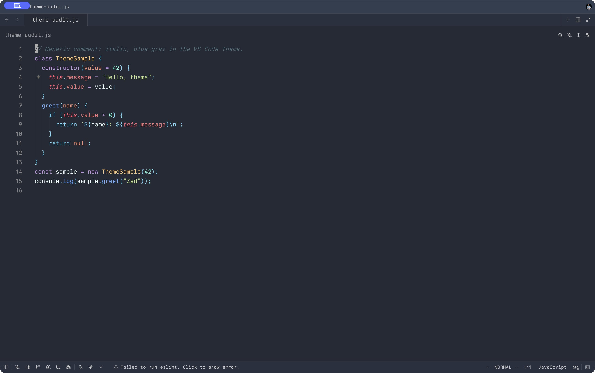
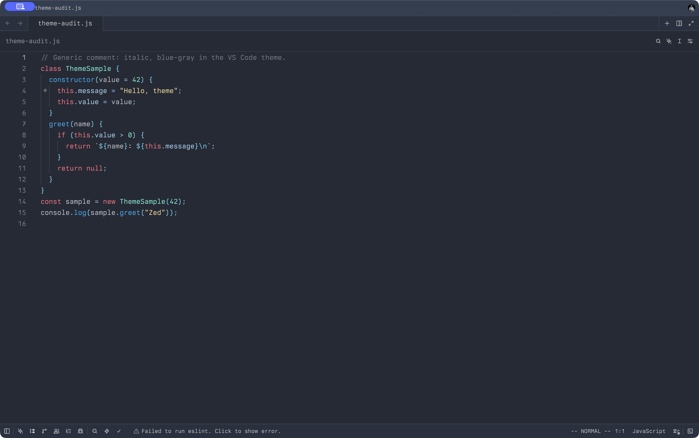

# GDScript Theme for Zed

Two dark themes for [Zed](https://zed.dev), ported from
[James Sauer’s GDScript Theme for VS Code](https://gitlab.com/JamesSauer/GDScript-Theme-for-VSCode).
The original theme supplies the palette; this project adapts its colors and styles to Zed.

[Preview and download both themes on zed-themes.com](https://zed-themes.com/themes/mLfTbfEpDD51YDtyWMLt1).

The source theme was checked against GitLab’s latest
[master revision, `1dbd193`](https://gitlab.com/JamesSauer/GDScript-Theme-for-VSCode/-/commit/1dbd193e598ef5d37a029e106ec0601456113123),
on October 26, 2026. Its theme file is byte-for-byte identical to the installed VS Code
extension version 1.0.2 used for this port. GitLab’s package metadata still says 1.0.1.

## Themes

| Theme | Palette |
| --- | --- |
| **GDScript** | The original theme’s general coding palette: purple declarations, cyan control keywords, green strings, mint numbers, and italic blue-gray comments. |
| **GDScript — Godot** | The original theme’s GDScript palette applied across languages: pink keywords, blue functions, yellow strings, mint numbers, and plain gray comments. |

Both variants share the dark blue-gray interface, cursor and selection colors, and terminal palette.

Markdown previews use the original editor’s near-white `#EEFFFF` foreground.
Normal file and folder labels use VS Code’s opaque `#CCCCCC` UI foreground.
Zed shares these text roles with other interface labels, so those labels inherit the same colors.

### GDScript

### GDScript — Godot

## Install

Open Zed’s Extensions panel, search for **GDScript Theme**, and install it.
If the extension is not listed yet, use one of the local installation methods below.

Open the command palette and run `theme selector: toggle`, then choose
**GDScript** or **GDScript — Godot**.

### Local theme files

Copy `themes/gdscript.json` to `~/.config/zed/themes/` on macOS or Linux.
On Windows, use `%USERPROFILE%\AppData\Roaming\Zed\themes\`.
Restart Zed if the themes do not appear in the theme selector.

### Development extension

Clone this repository, run `zed: install dev extension` from Zed’s command palette,
and select the repository directory containing `extension.toml`.

## Differences from VS Code

VS Code uses TextMate scopes; Zed uses syntax captures. Some context-dependent colors,
including language-specific attributes and nested JSON keys, cannot be represented exactly
by a shared theme. Zed also combines some interface roles that VS Code colors separately.

The **GDScript — Godot** variant applies its palette globally; it does not switch colors
based on the current language. This extension provides colors only. Install Zed’s separate
GDScript language extension if you need GDScript language support.

Fonts, font sizes, editor layout, and language servers remain your own editor settings.

## Credits and license

- Original theme: [James Sauer / GDScript Theme for VS Code](https://gitlab.com/JamesSauer/GDScript-Theme-for-VSCode), version 1.0.2.
- Zed port: [Andrew Paramonov](https://github.com/AndrewP-GH).
- Initial conversion: [Migrazed](https://github.com/enBonnet/migrazed), followed by manual color and style corrections.

Licensed under the [MIT License](LICENSE). The original copyright and permission notice are preserved.
